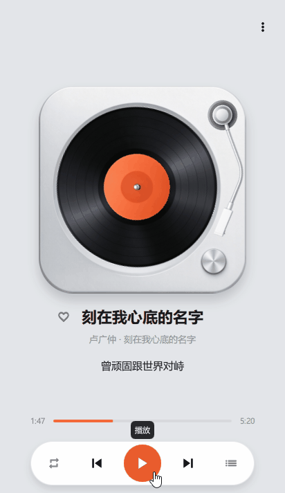
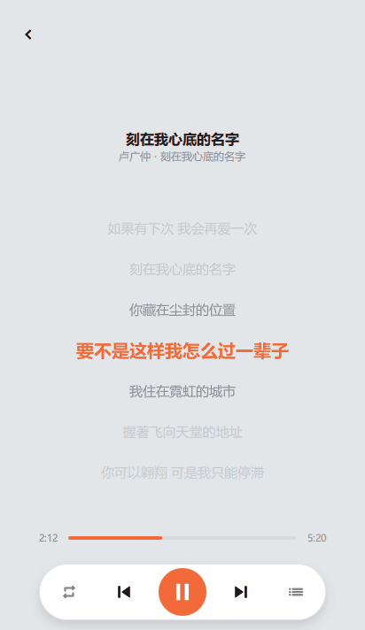

# Music Player

基于 Qt 6 / QML 的本地音乐播放器。Windows 与 Android 已测试；Linux、macOS、HarmonyOS 理论上支持，尚未测试。

<p align="center">
  
  
</p>

## 功能

- 播放本地音频，支持 mp3 / flac / wav / m4a / aac / ogg / wma / ape / opus（实测过 MP3、FLAC 和 WAV）
- 添加歌曲支持一次选择多个文件，也可递归扫描整个文件夹，重复曲目自动跳过
- 自动加载与音频同名的 `.lrc` 歌词，支持 GBK / GB18030 编码
- 三档播放模式：列表循环、单曲循环、随机
- 收藏歌曲单独成列表，播放范围跟随来源列表
- 输出设备可选自动（蓝牙优先）或手动指定（仅 Windows，见「已知限制」）
- 音乐库管理支持全选与批量删除；单首歌曲可向左滑出删除按钮
- 播放列表点面板外即可收起
- Android 上可从文件管理器用本播放器打开音频
- 播放前校验文件是否仍可访问，被外部删除的曲目会提示并移出列表

> 单次添加上限 300 首。Android 上每首歌都要申请一次持久化 URI 读取权限，
> 而系统对单个应用的授权总数有限（Android 10 及以下 128 个、11 及以上 512 个），
> 超出的文件重启后会失效。歌曲较多时改用「扫描文件夹」——一个目录只占 1 个授权。

## 构建

### 依赖

- Qt 6.9 或更高版本，需要 `Core`、`Gui`、`Qml`、`Quick`、`QuickControls2`、`Multimedia`、`Core5Compat`、`Concurrent`
- CMake 3.16 或更高版本

`Core5Compat` 是必需的：`Qt5Compat.GraphicalEffects` 与歌词的 GBK 解码都依赖它。`Concurrent` 用于把文件夹扫描放到工作线程。`SafeArea`（系统栏避让）本项目用的是 `SafeArea.margins` 单例形式，它随 Qt 6.9 引入（`qquicksafearea.cpp` 标注 `\since 6.9`），所以最低版本是 6.9 —— 注意它与更早提供的 `Item.SafeArea` 附加属性不是同一个东西。

### Windows

```bash
cmake -S . -B build/win64 -G Ninja -DCMAKE_PREFIX_PATH="<Qt安装目录>/6.12.0/mingw_64"
cmake --build build/win64
```

也可以用 Qt Creator 打开 `CMakeLists.txt`，选好 Kit 后构建。

### Android

用 Qt Creator 配置 Android Kit 后构建。发布包需要用自己的 keystore 签名，先 `zipalign` 对齐，再 `apksigner sign`。

## 使用

1. 启动后点空态里的「去添加音乐」，或从右上角菜单选择「添加歌曲」「扫描文件夹」导入歌曲
2. 播放页点击歌词文字进入歌词页，点击任意一行可跳转到该时间点
3. 控制栏的列表按钮打开播放列表，可在「全部」和「我喜欢的」之间切换，也可在此管理曲库
   （点「编辑」进入批量管理，单首可左滑删除，点面板外收起）
4. 右上角菜单还可以切换输出设备（仅 Windows）、查看版本信息

Android 上文件读取权限随选择器一并申请，重启后依然可用。

## 项目结构

```
MusicPlayer/
├── CMakeLists.txt          # 构建配置
├── main.cpp                # 入口，注入 folderScanner / nativePlayer / fileOpenRelay / appVersion
├── app.rc                  # Windows 资源（应用图标）
├── Main.qml                # 主界面：只做属性、绑定与接线
├── src/                    # C++ 侧
│   ├── folderScanner.cpp/.h     # 文件夹扫描、content:// 查询、歌词读取、文件失效检测
│   ├── nativeaudioplayer.cpp/.h # 安卓原生播放器的 Qt 封装（JNI 转发 + 定时轮询状态）
│   └── playlistfile.cpp/.h      # 播放列表落盘（QSaveFile 原子写）
├── js/                     # 业务逻辑（PlayerActions / DeviceUtils / Format）
├── components/             # 24 个 QML 组件（含 Theme 配色单例）
├── assets/                 # 20 个 SVG 图标、唱机素材、应用图标
├── android/                # AndroidManifest、图标，以及 src/ 下的原生播放服务
├── docs/                   # 说明文档
├── tools/                  # 开发期验证脚本
└── keystore/               # 签名密钥，不入库
```

## 技术栈

- 界面全部用 QML；C++ 只负责系统桥（`FolderScanner`、`NativeAudioPlayer`）与启动时的上下文注入
- 界面只做接线，业务逻辑放在 `js/` 下；JS 拿不到 QML 上下文，界面把对象打包成
  `ctx = { root, store, engine, lyrics, fs }` 传进去
- 配色统一走 `components/Theme.qml` 单例，业务代码不写字面量颜色
- Qt Quick Controls 2，使用 Basic 样式
- 播放分两条链路，由 `PlaybackEngine.qml` 的 `useNative` 分派：
  Windows 用 Qt Multimedia 的 `QMediaPlayer`；Android 用系统原生 `MediaPlayer`
  （`nativeaudioplayer` + `android/src/PlaybackService.java`）
- 桌面与 Android 共用同一套 QML，路径差异集中在 `FolderScanner`（桌面用 `QDir`，Android 用 SAF）
- 播放模式与输出档位（仅 Windows 生效）通过 `Settings` 持久化

## 已知限制

- 没有应用内音量调节，跟随系统音量
- 没有歌曲搜索
- 输出设备选择只对 Windows 开放：Android 没有可供普通应用指定输出设备的公开 API
  （`setPreferredDeviceForStrategy` 是 `@SystemApi`），且播放已交给系统原生播放器，路由由系统决定
